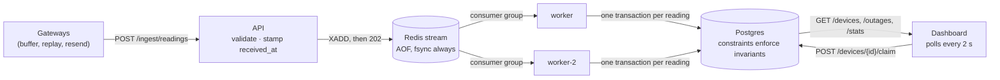
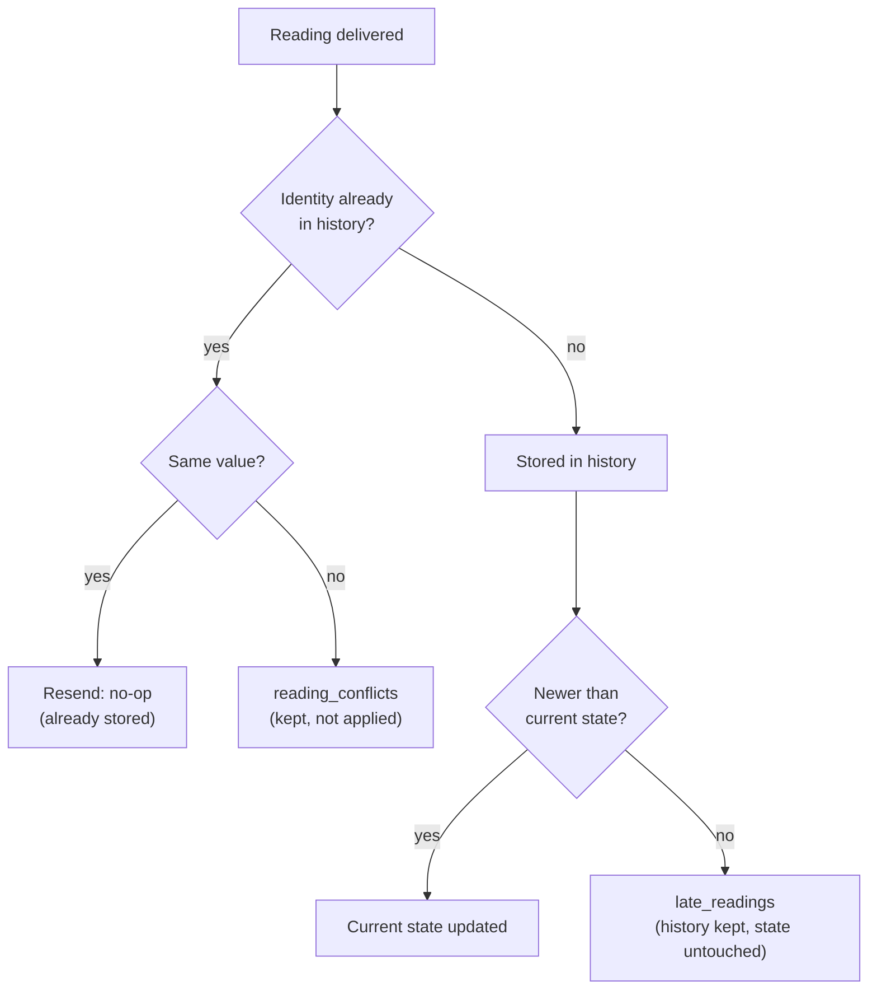
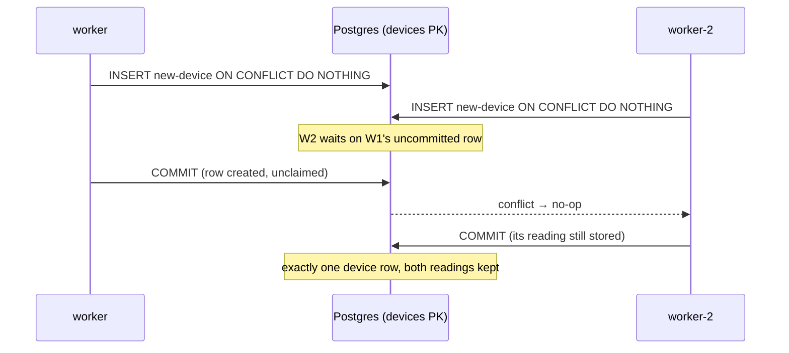
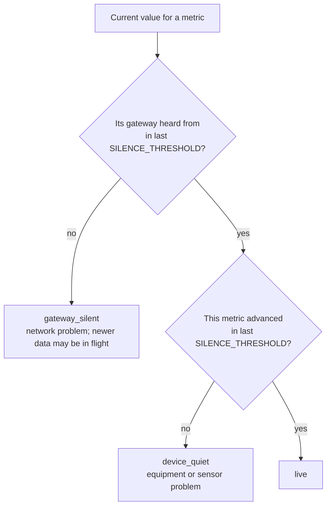
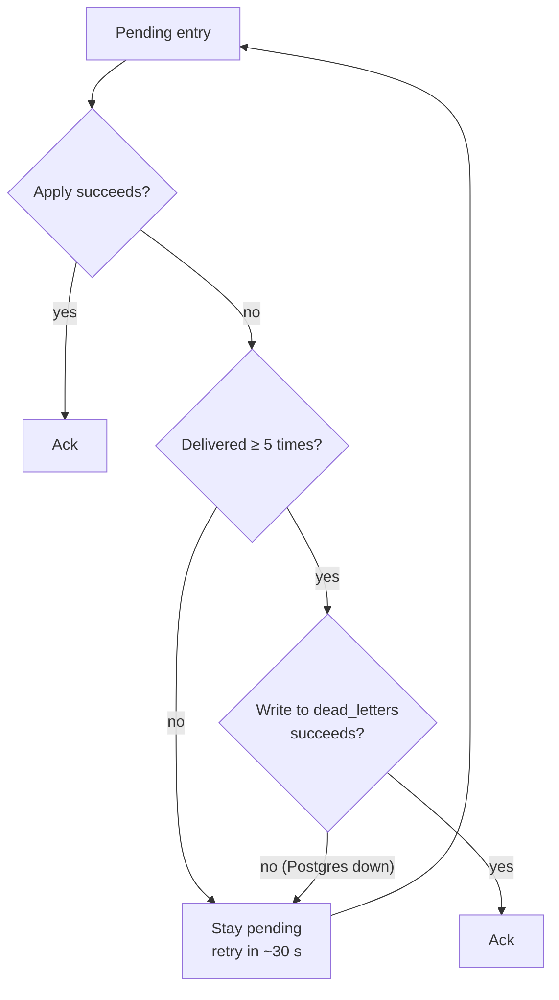

# Decision Log

DESIGN.md is the two-page argument. This is the longer record behind it: each
decision made while reviewing and hardening the first build, what problem
forced it, the options weighed, and the commit that implements it. Every bug
below was reproduced against the running system before its fix and re-run
after.

The rule that ties them together: **never drop, never block, always record.**
A conflicting resend, a broken-clock reading, an entry that can't be applied, a
silent gateway: each is kept and flagged, never discarded or allowed to stall
the pipeline.

| # | Decision | Commit |
|---|---|---|
| 1 | Queue durability: Redis persists every write | `cfcb8f0` |
| 2 | What counts as a duplicate: identity includes event time | `3cc04be` |
| 3 | Untrustworthy timestamps: quarantine | `6c409dc` |
| 4 | Registration under real concurrency: two workers | `dae01f5` |
| 5 | Late data: never hold back, flag staleness with a cause, log outages | `473f71c` |
| 6 | Dashboard liveness: polling, connection-lost banner, newest devices first | `d02c8b2`, `3ae4c4f` |
| 7 | Unappliable entries: dead letters | `39793cc` |

## System overview

The API never touches Postgres on the ingest path, so the slowest thing a
gateway can observe is a Redis write.

### One reading's path through a worker

1. **Register the device** if new: `INSERT ... ON CONFLICT DO NOTHING` on the primary key (decision 4).
2. **Insert into history** by identity. Same identity, same value: a resend, stop. Same identity, different value: record in `reading_conflicts`, stop (decision 2).
3. **Quarantine check:** more than 5 minutes ahead of its receive time → kept, flagged, stop (decision 3).
4. **Guarded upsert** of current state. If a newer reading already holds it, record in `late_readings` (decisions 3, 4).
5. **Gateway bookkeeping:** if the gateway had been silent past the threshold, write one `gateway_outages` row (decision 5).
6. **Commit, then ack.** Failures stay pending and retry; after 5 deliveries the entry is dead-lettered (decision 7).

## Decision 1: a queue that must not forget

**Kept** FastAPI + Redis Streams + Postgres. Streams give consumer groups,
acks, a pending list and reclaim of a dead worker's entries in one small
container. Kafka has the best 10× story but is heavy for a 3-day build;
RabbitMQ offers no real advantage here. A lightweight broker is safe because
**correctness never depends on the queue's order or delivery count**: the
database dedupes and guards ordering.

**Problem, demonstrated:** worker stopped, reading POSTed (202), Redis killed
without saving, restarted. The reading was gone from both queue and Postgres,
after the gateway had been told it was accepted.

**Options:** `appendfsync everysec` (up to ~1 s of accepted readings at risk)
vs `always` (no loss, slower per write, irrelevant at this scale).

**Chosen:** `always`, a named volume, and `restart: unless-stopped` on api and
workers. Verified by SIGKILLing the Redis container holding an unprocessed
reading: it survives and lands. At 10×: `everysec` plus a replica, with the
one-second window stated.

## Decision 2: what counts as a duplicate

**Problem:** the original identity was `(gateway, device, metric, sequence)`.
The brief never defines `sequence`, the generator numbers it four ways, and a
rebooted gateway restarts its counter. New readings collided with old ones and
were silently dropped, while current state still updated to them: the
dashboard showed a value that existed nowhere in history.

| Generator scenario | How `sequence` is numbered |
|---|---|
| clean | restarts at 0 per device per gateway |
| replay | gw-0 from 1000, gw-1 from 0 |
| race | both gateways send 0 |
| trace | 0 to 5, shared across both gateways |

**Options:**
- A. `gateway, device, metric, sequence` (original): a counter reset loses data.
- **B. A + `event_time` (chosen):** true resends are byte-identical and still collapse; a reset counter has new timestamps and is kept.
- C. drop `sequence`, key on `event_time`: two real readings in the same instant would merge.
- D. all six fields: a corrected resend becomes a second reading.

**Safety nets:** same identity with a different value goes to
`reading_conflicts`, never dropped; current state only changes if the reading
actually landed in history.

Two gateways reporting the same device produce two history rows on purpose:
two observations from two sources, not one reading delivered twice.

## Decision 3: untrustworthy timestamps

**Kept:** one current row per device and metric, overwritten only by a strictly
newer `(event_time, sequence)`. A replayed backlog loses every comparison, so
arrival order never matters.

**Problem, demonstrated:** newest-wins trusts every timestamp. One reading
stamped 2099 became current and every real reading lost to it: the metric was
frozen until 2099.

**Options:** reject at the API (a bad-clock gateway loses everything);
**quarantine (chosen)**: keep exactly as sent, flag it, never let it drive
state; clamp to now (invents data, destroys evidence).

**Why 5 minutes:** honest skew is seconds to ~2 minutes; broken clocks are off
by hours to decades. 5 minutes sits in the gap with headroom, and is the
longest a bad clock can freeze a metric. Judged once against the API's receive
time and stored, so a reading can't become valid later and sneak into state.
Its gateway is flagged "clock ahead" until a sane reading arrives.
`FUTURE_TOLERANCE_SECONDS` configures it. NaN and ±∞ are rejected with 400.

**Limit:** clocks running *slow* aren't detected; one reading from a slow clock
looks like backlog (CUTS.md).

## Decision 4: registration under real concurrency

**Kept:** the first reading of an unknown device inserts an `unclaimed` row;
`device_id` is the primary key, so the second racer waits for the first commit
and no-ops. Claiming is a guarded transition: a second claim gets 409.

**Problems found:**
1. **The race scenario didn't race.** With one worker the queue serialized the
   two first-reports, so the database guarantee was never exercised.
2. **"Scaling is a config change" was false.** Workers named themselves by PID,
   which is 1 in every container, so all would share one consumer name. Now
   named by hostname + PID.
3. **Surfaced by running two workers:** the late check read state before
   writing it, so two workers could interleave and miss a late flag. Fixed by
   writing first and judging lateness from the result while the row is locked;
   pinned by a test that forces the interleaving and fails on the old code.

**Known means claimed:** the generator's `known-device-…` IDs carry a random
run tag, so nothing could pre-register them. Every device starts unclaimed.

**Verified:** two live workers split 300 entries 138/162, each handled once;
all scenarios over 3 rounds kept every invariant.

## Decision 5: late data, and when to stop waiting

"Late data" hides two questions:

1. **Does an out-of-order reading change current state?** Only if newer, and
   newest-wins gives the same answer in any arrival order. **Waiting never
   makes current state more correct; it only delays it.**
2. **When should the system stop trusting that what it shows is current?** That
   is where the "late enough" threshold belongs.

**The use case decides it.** Commissioning technicians run functional tests
(change a setpoint, watch the response) and need seconds. Their costliest
failure is stale data that looks live. Conclusions over a time window are where
waiting matters, and those need to know which windows were incomplete.

**Options:**
- Hold-back window (watermark) of N min: every value always N min old; an outage longer than N still needs a late path. Rejected.
- Never wait, no signal (original): live and convergent, but no outage visible while it happens.
- A few-second jitter buffer: buys nothing, since reordering is already harmless.
- **Never wait + freshness with a cause + outage log (chosen).**

```mermaid
gantt
  title One gateway offline 10:00–10:05
  dateFormat HH:mm
  axisFormat %H:%M
  section Hold-back (N = 5 min)
  Every device's view 5 min behind, always :crit, 10:00, 10:12
  section Never wait (chosen)
  Healthy gateways: live                   :done, 10:00, 10:12
  Offline gateway's devices: flagged        :active, 10:01, 10:05
  Backlog applied, outage row written       :milestone, 10:05, 0m
```

A hold-back window charges the outage's cost to every value, all the time;
never-wait charges it only to the affected gateway, only while it lasts.

The gateway check comes first: when a gateway is silent, every device on it is
behind for the same reason. Silence is measured on the API's receive clock, so
a backed-up queue or stopped worker never looks like an outage.

**Why 60 s:** about 3× a healthy gateway's reporting interval, so jitter never
trips it and an outage shows within a minute. `SILENCE_THRESHOLD_SECONDS`.

**Offline an hour instead of a minute:** the flag honestly sits for an hour;
on reconnect the durable queue absorbs the burst and two workers drain it; one
outage row is written. **What breaks first is outside the system:** the
gateway's own buffer can overflow before it reconnects, and since `sequence`
isn't guaranteed gapless, that loss can't be reliably detected.

## Decision 6: how the dashboard stays live

**Polling every 2 s, not push.** Plenty for functional tests, and the dashboard
itself runs on job-site Wi-Fi: polling recovers on its own, push needs
reconnect-and-catch-up logic.

**Gap closed:** a failed poll left old values on screen looking live. A red
"Connection lost, showing data from HH:MM" banner now appears. Verified in a
browser: server killed, banner within 4.5 s; server back, banner clears.

**Also:** unregistered devices appear newest first with "first seen Ns ago via
gateway", since the brief asks to see *when* one starts reporting.

**Cut:** every poll returns every device; at 10× this becomes push or "changed
since T" (CUTS.md).

## Decision 7: a reading that can never be applied

**Problem, demonstrated:** a `sequence` of 10^20 passed validation (202),
overflowed Postgres's bigint, and crashed the worker on every retry. With a
restart policy that is a crash loop: one bad reading stalls a whole site.

**Options:** catch and skip (silently loses a reading, breaks invariant 1);
retry forever (the crash loop); **dead-letter after N attempts (chosen).**

**Two layers:** the API now rejects an oversized `sequence`; dead letters cover
inputs nobody has thought of yet.

The apply is always attempted first, so a Postgres outage dead-letters nothing:
the dead-letter write fails too and entries wait in the durable queue (tested:
8 deliveries while down, then applied, 0 dead letters). The dead letter is
written before the ack, so an entry is never in neither place. Five attempts
≈ 2.5 minutes of consistent failure. `WORKER_MAX_ATTEMPTS`.

## Verification record

- 25 tests against real Postgres and Redis, passing locally and in CI.
- All generator scenarios and the seeded trace (`--seed drtclem`) on a fresh
  clone with `docker compose up` and two workers; the trace matched DESIGN.md
  across 15 repeated runs.
- Redis crash durability by SIGKILLing the container.
- Dashboard checked in a real browser, including the connection-lost banner.
