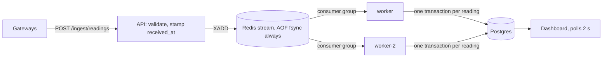

# Design — Equipment Telemetry Ingestion

## The problem as I understood it

Commissioning teams verify equipment by functional testing: change a setpoint,
watch the response. Gateways on job-site networks drop, buffer and replay. The
system must keep every reading exactly once, show each device's true newest
state whatever the arrival order, and register a new device once even when
gateways race. The costliest failure at the dashboard is **stale data that
looks live**: a false "no response" mid-test.

**The queue may repeat or reorder; the database makes the effect
exactly-once.** It must not forget, so Redis fsyncs every write before the
API's 202. Each
decision below is argued in full, with diagrams, in [DECISIONS.md](DECISIONS.md).

## How each invariant holds

**1. Never duplicated or lost.** Identity is `(gateway, device, metric,
sequence, event_time)`. The brief never says `sequence` is unique, and a
rebooted gateway restarts it, so `sequence` alone discards real readings. A true
resend is byte-identical and collapses; same identity with a different value
goes to `reading_conflicts`. An entry that can never be applied goes to
`dead_letters` after 5 deliveries instead of crash-looping the worker. Every
delivery ends in history or in a ledger saying why not.

**2. Current state is the true newest reading.** A guarded upsert overwrites
only if `(event_time, sequence)` is strictly newer, so a replayed backlog loses
every comparison in any order, and state changes only if the reading landed in
history. A reading over 5 minutes ahead of its receive time (a broken clock) is
kept but **quarantined**, never current; otherwise one reading stamped 2099
freezes the metric forever.

**3. Registered exactly once.** `device_id` is the primary key; first report is
`INSERT ... ON CONFLICT DO NOTHING`, so the second racer waits for the first
commit, then no-ops. Compose runs **two workers** so the race is genuinely
concurrent. Devices start `unclaimed` ("known" means
claimed); a second claim gets 409.

## Late data: the decision

"Late data" hides two questions. **Should an out-of-order reading change current
state?** Only if newer, and newest-wins answers the same in any order, so
**holding data back never makes current state more correct; it only delays
it.** **When should the system stop trusting that what it shows is current?**
That is where the "late enough" threshold belongs: on trust, not on data.

| Option | Verdict |
|---|---|
| Hold-back window (watermark) of N min | Rejected: every value N min old, always; an outage longer than N still needs a late path. |
| Commit immediately, no signal (original) | Live and convergent, but nothing shows an outage while it happens. |
| **Commit immediately + silence threshold + outage log** | **Chosen.** |

Each value reports freshness with a cause: **gateway silent** (nothing from its
gateway for `SILENCE_THRESHOLD_SECONDS`, default 60, ~3× a reporting interval:
a network problem) or **device quiet** (gateway reporting, metric not
advancing: an equipment finding). When a silent gateway returns, one
row goes into `gateway_outages`, so a report over a time window can tell
whether it was complete without delaying the live screen. "Late" means applied
after a newer reading for that metric was already current.

**Offline a minute vs an hour.** A minute: a brief silent flag, the backlog
fills history, one outage row. An hour: the flag honestly sits for an hour, then
the durable queue absorbs the burst. **What breaks first is outside the
system:** the gateway's buffer can overflow before it reconnects, and since
`sequence` isn't guaranteed gapless, that loss can't be reliably detected.

## Seeded trace (`--scenario trace --seed drtclem`)

Device `trace-device-6462`; gw-a/gw-b are `gw-a-drtclem`/`gw-b-drtclem`; times
relative to base T; rows in arrival order; 2′ is a byte-identical resend of #2.

| # | gw | metric | value | event | stored? | current after | late? |
|---|---|---|---|---|---|---|---|
| 0 | a | vibration | 91.38 | T+5 | yes (registers device) | vib 91.38 | no |
| 1 | a | temperature | 98.03 | T+2 | yes | temp 98.03 | no |
| 2 | b | temperature | 43.27 | T+1 | yes | temp 98.03 | **yes** |
| 3 | b | vibration | 77.4 | T+4 | yes | vib 91.38 | **yes** |
| 4 | a | status | 11.98 | T+0 | yes | status 11.98 | no |
| 5 | a | vibration | 89.76 | T+3 | yes | vib 91.38 | **yes** |
| 2′ | b | temperature | 43.27 | T+1 | no: resend | unchanged | no |

**Predicted:** 6 history rows from 7 deliveries; vibration 91.38, temperature
98.03, status 11.98; 3 late (#2, #3, #5);
nothing quarantined; metrics *live*, then *gateway silent* 60 s later; no outage
row. **Actual:** matches on every point, on a fresh `docker compose up` with two
workers, across 15 runs.

## At 10× the gateways

Workers already scale out via the consumer group. What gives next: (1) **Postgres writes** → batch applies, partition
`readings` by time; (2) **hot device rows** → shard the stream by `device_id`;
(3) **per-write fsync** → `everysec` plus a replica; (4) **full polling** →
push. None changes the invariants.
