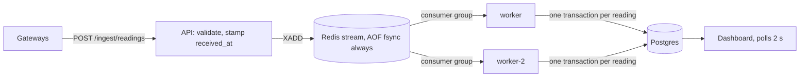

# Design — Equipment Telemetry Ingestion

## The problem as I understood it

Commissioning teams verify building equipment by functional testing: change a
setpoint, watch the response. Gateways on construction-site networks drop,
buffer, and replay. The system must keep every reading exactly once, show each
device's true newest state whatever the arrival order, and register a new device
once even when gateways race. The costliest failure for the person at the
dashboard is **stale data that looks live**: a false "no response" mid-test.

**The queue may repeat or reorder; the database makes the effect
exactly-once.** The queue must not forget: the API answers 202 after `XADD`, so
Redis persists every write (`appendfsync always`) on a volume, verified by
SIGKILLing Redis holding an accepted, unprocessed reading.

## How each invariant holds

**1. Never duplicated or lost.** A reading's identity is
`(gateway, device, metric, sequence, event_time)`. The brief never says
`sequence` is unique (the generator numbers it differently per scenario, and a
rebooted gateway restarts its counter), so `sequence` alone would discard real
readings as duplicates. A true resend is byte-identical and collapses. Same
identity with a *different* value goes to `reading_conflicts`, never silently
dropped. An entry that can never be applied is moved to `dead_letters` (raw
payload + error) after 5 failed deliveries instead of crash-looping the worker;
it is written before it is acknowledged, so a Postgres outage dead-letters
nothing. Every delivery ends in history or in a ledger saying why not.

**2. Current state is the true newest reading.** One guarded upsert per
reading: it overwrites only if `(event_time, sequence)` is strictly newer, so a
replayed backlog loses every comparison regardless of order. State only changes
if the reading actually landed in history. Event time is untrusted input: a
reading more than 5 minutes ahead of its receive time (a broken clock) is kept
in history but **quarantined** and never becomes current, or one reading stamped
2099 would freeze the metric forever. The verdict is made once, at receive time.

**3. Registered exactly once.** `devices.device_id` is the primary key;
first-report is `INSERT ... ON CONFLICT DO NOTHING`, so the second racer waits
for the first to commit, then no-ops. Both readings are kept (two observations,
not one reading twice). Compose runs **two workers** so the race is genuinely
concurrent; with one, the queue serialized it. Devices start `unclaimed`; a
second claim gets 409. "Known" means claimed: the generator's `known-device-…`
IDs carry a run tag, so nothing could pre-register them.

## Late data: the decision

"Late data" hides two questions.

1. **Should an out-of-order reading change current state?** Only if newer, and
   newest-wins gives the same answer in any arrival order. So **holding data
   back can never make current state more correct.** It only delays it.
2. **When should the system stop trusting that what it shows is current?** That
   is where the "late enough" threshold belongs: on trust, not on data.

| Option | Verdict |
|---|---|
| Hold-back window (watermark) of N min | Rejected: every value is N min old, always, breaking functional testing; an outage longer than N still needs a late path. |
| Commit immediately, no signal (original build) | Live and convergent, but nothing indicates an outage *while it happens*. |
| **Commit immediately + silence threshold + outage log** | **Chosen.** |

Each metric reports freshness with a cause: **gateway silent** (nothing from
its gateway for `SILENCE_THRESHOLD_SECONDS`, default 60, ~3× a site's reporting
interval: a network problem, newer data may be in flight) or **device quiet**
(gateway reporting, metric not advancing: itself a commissioning finding).
Silence is measured on the API's receive clock, so a backed-up queue never looks
like an outage. When a silent gateway speaks again, one row goes into
`gateway_outages`. Conclusions over a time window ("reached 55°F in 10 min") are
where waiting does matter; the outage log makes incomplete windows knowable
without delaying the live screen. The dashboard holds itself to the same rule: a
failed poll shows "connection lost, data from HH:MM".

"Late" stays precise: applied after a newer reading for the same metric was
already current. It is stored and recorded in the late ledger.

**Offline a minute vs an hour.** A minute: a brief silent flag, the backlog
fills history, state picks up anything newer, one outage row. An hour: the flag
honestly sits for an hour, then a burst the durable queue absorbs and two
workers drain. **What breaks first is outside the system:** the gateway's own
buffer can overflow and drop readings before it reconnects, and since `sequence`
isn't guaranteed gapless, we can't reliably detect that loss.

## Seeded trace (`--scenario trace --seed drtclem`)

Device `trace-device-6462`; times relative to base T; arrival order is row
order; the last row is a byte-identical resend of #2.

| # | gateway | metric | value | event time | stored? | state after | late? |
|---|---|---|---|---|---|---|---|
| 0 | gw-a | vibration | 91.38 | T+5 | yes; device registers (first gateway gw-a) | vib 91.38 | no |
| 1 | gw-a | temperature | 98.03 | T+2 | yes | temp 98.03 | no |
| 2 | gw-b | temperature | 43.27 | T+1 | yes | temp stays 98.03 | **yes** (T+1 < T+2) |
| 3 | gw-b | vibration | 77.4 | T+4 | yes | vib stays 91.38 | **yes** (T+4 < T+5) |
| 4 | gw-a | status | 11.98 | T+0 | yes | status 11.98 | no |
| 5 | gw-a | vibration | 89.76 | T+3 | yes | vib stays 91.38 | **yes** (T+3 < T+5) |
| 2′ | gw-b | temperature | 43.27 | T+1 | no: same identity, same value | unchanged | no (not stored) |

**Predicted:** 6 history rows from 7 deliveries; vibration 91.38, temperature
98.03, status 11.98; 3 late (#2, #3, #5); nothing quarantined (T+5 is seconds
ahead); metrics *live*, then *gateway silent* 60 s after the run; no outage row
(neither gateway speaks again). **Actual:** matches on every point, on a
fresh `docker compose up` with two workers and across 15 repeated runs. Lateness follows apply order;
the generator's 50 ms spacing keeps that equal to arrival order.

## At 10× the gateways

Workers already scale out (consumer group; any worker reclaims a dead one's
entries). What gives next, in order: (1) **Postgres writes**, one multi-statement
transaction per reading → batch applies, partition `readings` by time; (2) **hot
devices** contending on one state row → shard the stream by `device_id` so each
device has one consumer; (3) **per-write fsync** → `everysec` plus a replica;
(4) **polling** returns every device → push or "changed since T". None changes
the invariants; they sit below the constraint layer.
